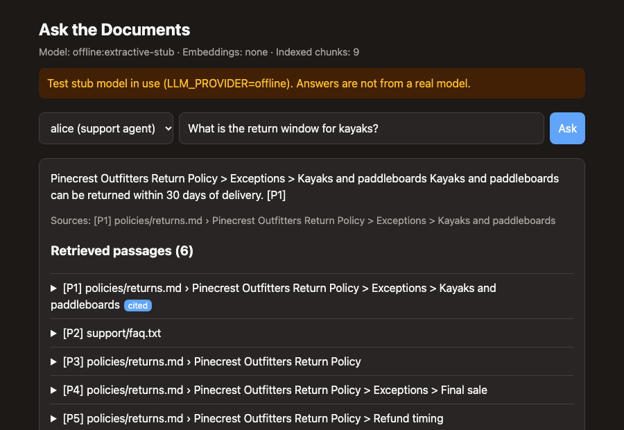

# rag-prototype-builder: a skill that builds a RAG prototype

Turn "answer questions about these documents, and each user only sees their own folders" into a **working, tested app in one sitting**.

Without the skill you have to explain chunking, citations, access control, prompt injection, evals and CI in every conversation. With the skill installed, Claude does all of this every time:
- starts from a tested template
- writes a plan and waits for your approval
- builds one measured milestone at a time
- checks its own work against hard rules



*The bundled app answering as user `alice`, with a cited source and the passages it retrieved. The yellow banner shows that the labelled offline test stub is on, so no API key was needed.*

## What you get
- **A working app.** It has:
  - a FastAPI backend and a one-page UI (no build step, no CDN)
  - ingestion for md, txt, pdf, csv, json and html
  - BM25 search, with embeddings and RRF hybrid search when you turn them on
  - cite-or-abstain answers, with a shape check and a check that every number comes from a cited passage
  - per-user folder rules applied inside search (the user picker is a simulation: there's no login)
  - prompt-injection defences
- **Proof that it works.** 37 offline tests on their own fixtures (so they pass with your documents too), regression baselines for the fixtures and for your questions, a local `ci.sh` whose `--live` stage refuses the stub and fails on any failed item, and an eval CLI with `hit@k`, `MRR`, citation, abstention and judge metrics.
- **A process.** A plan-before-code gate, milestone evidence and plain-language reporting, with a `project-manager` agent included.
- **Guardrails checked by code.** `check_rules.py` fails the build if someone:
  - lets the client send filters
  - silently falls back to a fake model
  - removes the citation guard
  - uses `innerHTML`
  - commits a key

## Install

### Claude Code
```bash
git clone https://github.com/itsbhoomika/rag-prototype-skill.git
```
```bash
mkdir -p ~/.claude/skills && cp -R rag-prototype-skill/rag-prototype-builder ~/.claude/skills/
```
This installs the skill for all your projects. To install it for one project only, copy the folder into that project's `.claude/skills/` instead.

### Claude.ai
1. Download `rag-prototype-builder.zip` from the latest Release, or build it with `./dev/scripts/package.sh`.
2. Open Claude.ai and go to **Settings > Capabilities > Skills**, then click **Upload skill** and pick the zip.
3. Toggle the skill on.

The skill runs best in Claude Code, because it scaffolds files and runs tests.

### Requirements
- Python 3.10+
- `uv` (recommended) or `pip`
- A model API key (Anthropic, OpenAI, Azure, Gemini or Ollama) for real answers. Everything else runs offline.

## Use it
Ask in plain words:
- "Build a RAG over the PDFs in ./handbook. HR sees everything, staff only see policies."
- "Spin up a RAG prototype I can practise on."
- "Retrieval misses paraphrased questions, add embeddings."

Claude then:
1. asks what's missing
2. runs `scripts/scaffold.py`
3. drafts `PLAN.md` and stops for your approval
4. builds milestones M1–M5, running tests and `check_rules.py` at each gate
5. reports metrics with item counts, trade-offs and what isn't built

To check that the skill is loaded, ask Claude: "When would you use the rag-prototype-builder skill?"

## Repository layout
```
rag-prototype-builder/          the skill (this folder is what gets installed or zipped)
  SKILL.md                      workflow, critical rules, examples, troubleshooting
  references/                   12 focused docs, loaded only when a step needs them
  scripts/scaffold.py           copies the tested template into a new project
  scripts/check_rules.py        deterministic rule checks (exit 1 + file:line on violation)
  assets/template/              the full tested app (backend, frontend, tests, CI, sample data)
  assets/supabase-schema.sql    pgvector schema for the Next.js + Supabase variant
dev/                            maintenance only: never installed
  scripts/validate_skill.py     checks the skill against the skills guide's rules
  scripts/test_template.sh      scaffolds into a temp folder and runs the app's own CI
  scripts/package.sh            validates, then zips to dist/
  tests/                        tests for the skill's scripts
  evals/                        triggering tests (run via headless Claude Code) and functional scenarios
  CHECKLIST.md                  the guide's quick checklist, with evidence for each item
  CHANGELOG.md                  version history
docs/                           screenshot for this README
```

## Develop
All maintenance files live in `dev/`. Run these from the repo root:
```bash
uv run --with pyyaml python dev/scripts/validate_skill.py
```
```bash
uv run --with pytest --with pyyaml python -m pytest -q dev/tests
```
```bash
./dev/scripts/test_template.sh
```
```bash
python3 dev/evals/run_trigger_tests.py
```
- The first command checks the skill's structure against the guide.
- The second runs the tests for the skill's own scripts.
- The third builds the app the way a user would get it and runs its CI.
- The last one runs the triggering tests. It uses your Claude Code login.

GitHub Actions runs the first three and packages the zip on every push.

When you change the skill, bump `metadata.version` in `SKILL.md` and add a line to `dev/CHANGELOG.md`.

## Limits
- The Next.js + Supabase variant is documented with a schema, but the schema hasn't been run against a live database by this repo's CI.
- There is no real login. The user picker is a **simulation**: anyone who can reach the API can claim any user id. Folder rules are enforced on the server; production would take the user id from SSO/JWT.
- BM25 word statistics are computed over the whole corpus, so forbidden documents slightly shift the ranking of allowed ones (no content leaks). Strict isolation needs one index per access group.
- The guard checks numbers against the cited passages, not wording. Wording needs `eval --judge` with a real model.
- Offline CI measures plumbing and search, not answer quality. Run `./ci.sh --live` in a generated project with real keys for quality.

## License
MIT
